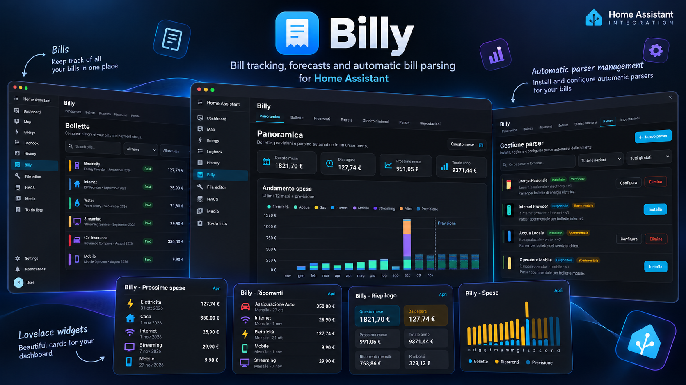
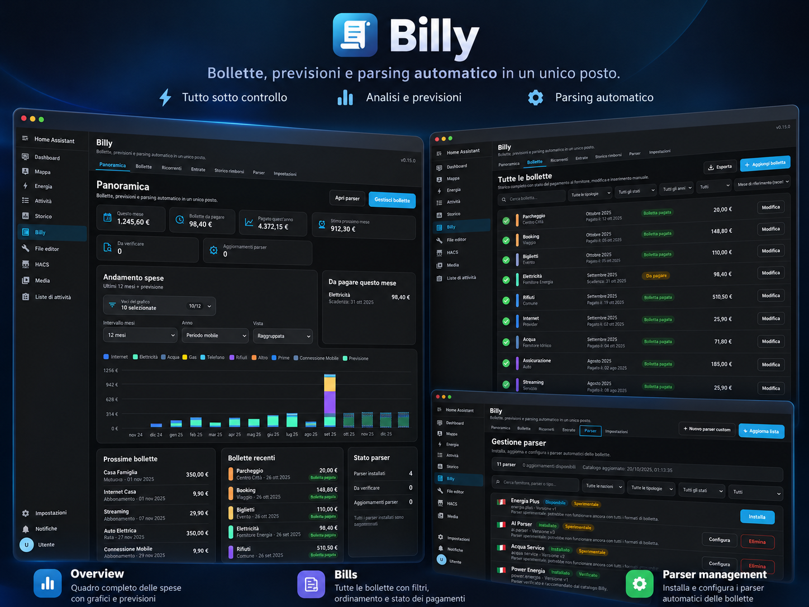
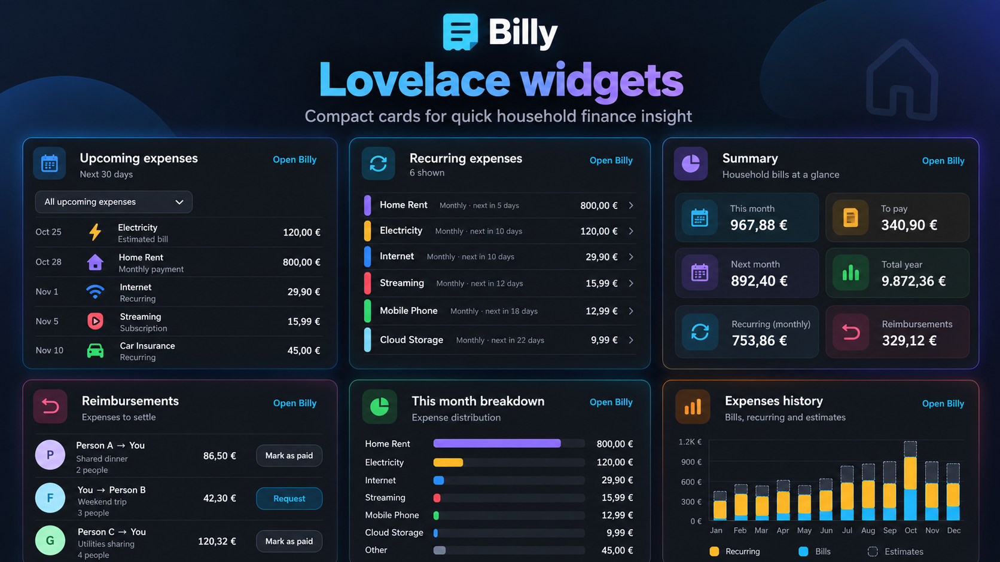

<p align="center">
  
</p>

<h1 align="center">Billy</h1>

<p align="center"><strong>Know what you owe. Plan what comes next.</strong></p>
<p align="center">Bills, recurring expenses, shared payments, forecasts and automatic email parsing — all inside Home Assistant.</p>

<p align="center">
  <a href="#installation">Get started</a> ·
  <a href="#features">Features</a> ·
  <a href="#lovelace-widgets">Lovelace widgets</a> ·
  <a href="docs/USER_GUIDE.md">User guide</a> ·
  <a href="CHANGELOG.md">Changelog</a>
</p>

<p align="center">
  
</p>

<p align="center"><sub>Promotional mockups use fictional sample data. Actual Home Assistant layouts may vary.</sub></p>

Billy is an open-source Home Assistant custom integration for organizing household finances **without connecting to your bank**. Manage provider invoices, track subscriptions and installment plans, split expenses between household members, and see upcoming costs before they are due.

## Features

| | |
|---|---|
| **Bills and payment history** | Record invoices, due dates, actual payment dates, payment status, bill types and PDFs. Search, filter, sort and export your history. |
| **Forecasts and spending charts** | Compare past expenses with upcoming bills, normalize irregular billing cycles and include recurring commitments. |
| **Recurring expenses** | Track subscriptions, rent, loans, mortgages and installment plans independently of utility invoices. |
| **Payers, accounts and transfers** | Split bills among payers, assign payments and income to multiple manually managed accounts, and record internal transfers. |
| **Reimbursements** | Track outstanding shares separately from provider payment status, including partial reimbursements and settlement history. |
| **Income tracking** | Record confirmed or expected income, including variable recurring salaries and one-time receipts. |
| **Automatic bill parsing** | Use Home Assistant IMAP sources and community YAML parsers to extract supported invoices from emails and PDFs. |
| **Parser community** | Discover providers across multiple countries, install and test parsers, share your own, and provide version-scoped feedback. |
| **Native Home Assistant UI** | A dedicated `/billy` sidebar with seven compact Lovelace dashboard widgets, localized in six languages. |

## Explore Billy

### Overview, bills and parser management

<p align="center">
  
</p>

The **Overview** combines spending trends and forecasts; **Bills** keeps due dates, payment dates, reimbursement status and PDF attachments accessible; **Parsers** discovers and manages declarative parser definitions from the [billy-parser community catalog](https://github.com/robin994/billy-parser).

### Lovelace widgets

<p align="center">
  
</p>

Add focused cards to existing Home Assistant dashboards:

| Widget | Card type |
|---|---|
| Summary | `custom:billy-summary-card` |
| Spending history | `custom:billy-spending-card` |
| Expense breakdown | `custom:billy-breakdown-card` |
| Upcoming expenses | `custom:billy-upcoming-card` |
| Recurring expenses | `custom:billy-recurring-card` |
| Reimbursements / balances | `custom:billy-balances-card` |
| Parser status | `custom:billy-parser-status-card` |

For example, on a **Sections** dashboard you can let the Upcoming widget fill the available width:

```yaml
type: custom:billy-upcoming-card
title: Upcoming expenses
days: 90
limit: 8
columns: full
```

Widgets use content-based heights by default. To align Recurring and Reimbursements cards, set the same optional `rows` value (for example `rows: 3`) on both. See the [Lovelace widget configuration guide](docs/USER_GUIDE.md#lovelace-dashboard-widgets) for other options.

## Installation

**Requirements:** Home Assistant 2026.3.0 or later. Billy is a custom integration, not a built-in Home Assistant component.

### HACS (recommended)

1. In HACS, add [`robin994/billy`](https://github.com/robin994/billy) under **Custom repositories** as an **Integration**.
2. Download/install **Bill Tracker** from HACS.
3. Restart Home Assistant.
4. Go to **Settings → Devices & services → Add integration**, search for **Bill Tracker**, and complete setup.
5. Open **Billy** in the sidebar at `/billy`.

### Manual installation

Copy the `custom_components/bill_tracker` folder into your Home Assistant `config/custom_components/` directory, restart Home Assistant, and add the **Bill Tracker** integration through **Devices & services**. Manual installs retain the same settings and data model.

After setup, create payers and bill types in **Billy → Settings**. You can add bills manually immediately; email parsing is optional.

## Optional automatic email parsing

Billy uses your existing **Home Assistant IMAP integration**. Configure your mailbox in Home Assistant, select the IMAP source under **Billy → Settings**, then refresh and install the parsers for the providers you use.

Parsers are **declarative YAML**, never downloaded executable code. Billy prefilters messages by metadata before fetching content, verifies/parser-matches attachments as needed, and supports review before importing. Only install parsers for providers you trust. Scanned image-only PDFs are not OCR-supported.

See [Automatic parsing documentation](docs/AUTOMATIC_PARSING.md), the [community parser catalog](https://github.com/robin994/billy-parser), and the [full user guide](docs/USER_GUIDE.md).

## Data, privacy and updates

- Billy stores bills, payer assignments, income and manually entered accounts within your Home Assistant environment. **It does not connect to bank APIs.**
- Your IMAP credentials remain with Home Assistant. The community parser publishing workflow does not attach the source email or bill PDF.
- Optional document archiving uses Home Assistant's media directory, including mounted network shares. Manual PDF management is administrator-only, subject to confirmation and an 8 MiB upload limit.
- Community parser feedback is version-scoped. See the [user guide](docs/USER_GUIDE.md#community-feedback) for its identifier/fingerprint behavior.
- Billy's built-in updater checks the repository's **`main` branch**, and installed updates require a **Home Assistant restart** before the new version runs. GitHub release downloads are not required for this mechanism.

For detailed configuration and security constraints, see [Income & document archive](docs/INCOME_AND_DOCUMENT_ARCHIVE.md) and [Monthly bill checklist](docs/BILL_PLACEHOLDERS.md).

## Documentation and release history

- [Full user guide](docs/USER_GUIDE.md)
- [Automatic parsing](docs/AUTOMATIC_PARSING.md)
- [Monthly bill checklist](docs/BILL_PLACEHOLDERS.md)
- [Income, accounts and document archive](docs/INCOME_AND_DOCUMENT_ARCHIVE.md)
- [Changelog — version-by-version updates](CHANGELOG.md)
- [GitHub issues and feature requests](https://github.com/robin994/billy/issues)

The deprecated `custom:bill-tracker-card` remains available to existing dashboards during Billy 0.x, but new dashboards should use the seven dedicated widgets. For Lovelace installations in YAML resource mode, register `/bill_tracker/billy-lovelace.js?v=0.15.1-r1` as a JavaScript module; keep the legacy `bill-tracker-card.js` resource only if an existing dashboard still uses it.

## Contributing and support

Bug reports, parser requests and improvements are welcome through [Billy issues](https://github.com/robin994/billy/issues). To publish or improve a provider-specific parser, use the [billy-parser repository](https://github.com/robin994/billy-parser).

Maintained by [@robin994](https://github.com/robin994). If you find Billy useful, consider [starring the repository](https://github.com/robin994/billy) or [supporting its development](https://paypal.me/rtortora94).

---
**Billy 0.15.1** · Open source · Home Assistant integration
